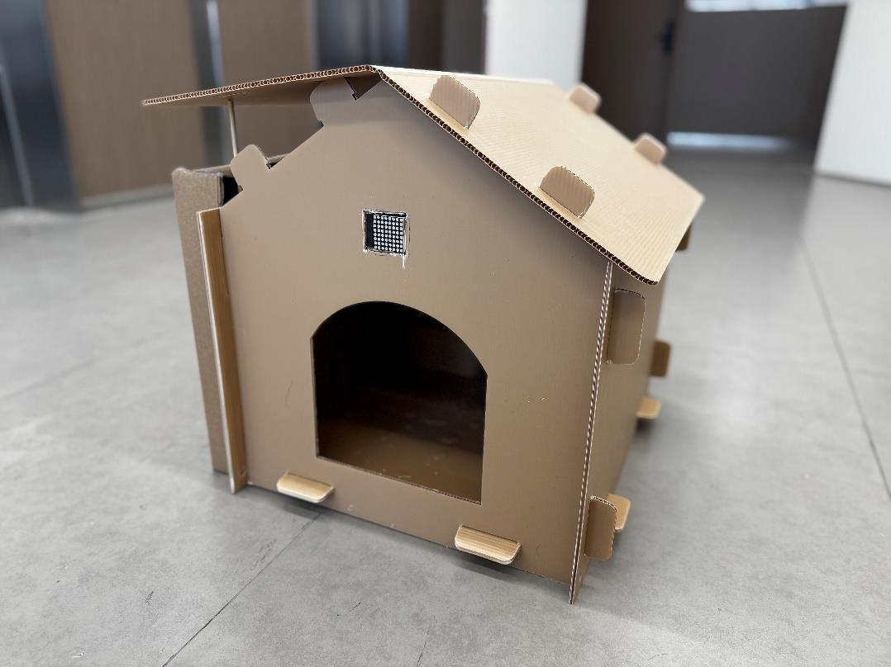
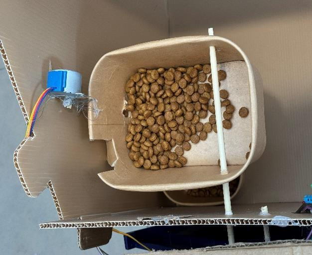
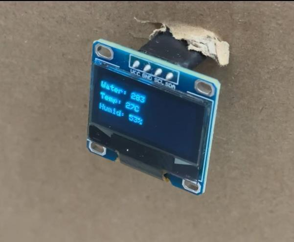
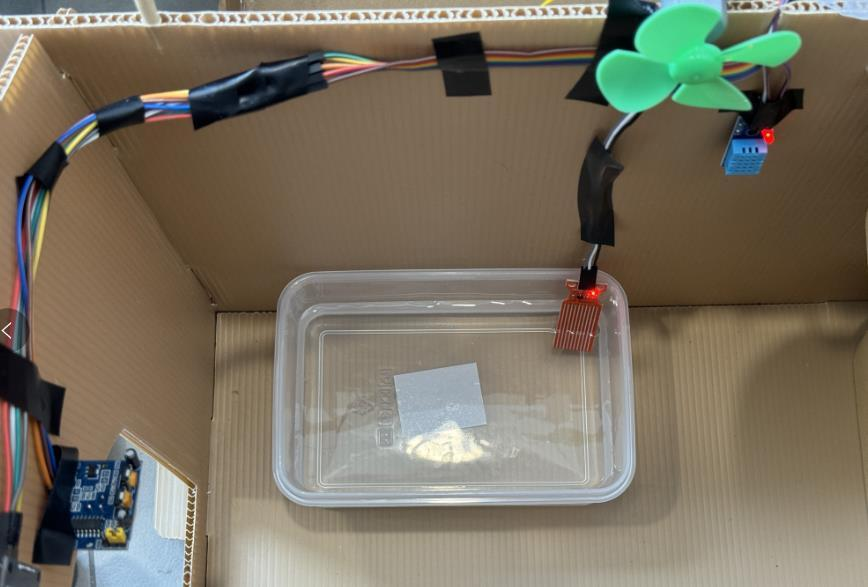
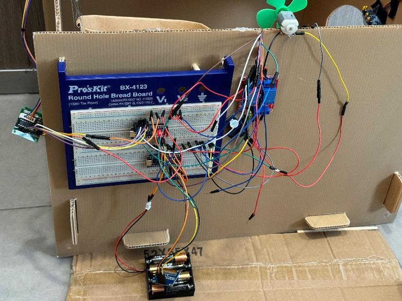
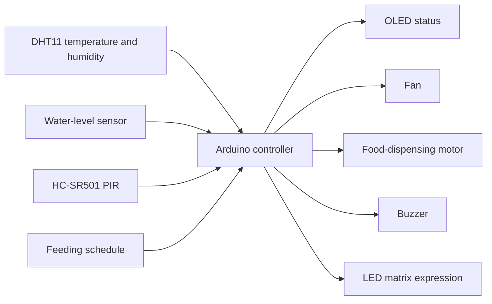

# Smart Cat House

An Arduino-based team prototype combining timed feeding, environmental monitoring, a water-level alert and a presence-responsive display in a modular cardboard enclosure.

**Firmware:** Written in C by Siyuan Lin for the Arduino-based prototype.

## Project demonstration

**[Watch or download the demonstration video](https://github.com/dddddddddl/smart-cat-house/releases/download/project-demo/smart_cat_house_demonstration.mp4)** · [Release page](https://github.com/dddddddddl/smart-cat-house/releases/tag/project-demo)

**Source availability:** We are sorry that the original firmware source files have been lost. Please see the demonstration video for the project presentation. This repository preserves an English design summary and selected prototype photographs; it does not contain replacement firmware presented as the original implementation.

## What we built

Our team combined sensing, small actuators and local displays to explore how an embedded system can support routine functions inside a cat-house prototype. The enclosure uses modular cardboard, with a motor-driven food mechanism and a separate electronics assembly.

| Function | Documented implementation |
|---|---|
| Timed feeding | Arduino-controlled motor and rotating dispensing rod |
| Environmental monitoring | DHT11 temperature/humidity sensor and OLED readout |
| Temperature response | Fan activation above the report's 27 °C threshold, with a display message |
| Low-water indication | Water-level sensor, display indication and buzzer alert |
| Presence response | HC-SR501 PIR input and a smiling-face LED matrix display |

These functions are described in the project materials. Without the original firmware, exact pin assignments, dependencies, scheduling behavior and error handling cannot be reconstructed reliably.

## How to review the project

1. Start with the **demonstration video** for the prototype presentation.
2. Read [design notes](docs/design.md) for the module relationships and the distinction between documented behavior and unverified details.
3. Browse the photographs below or [the asset guide](assets/README.md) to inspect the physical mechanism and electronics.

| Feeding mechanism | Local environment display |
|---|---|
|  |  |

| Fan and water sensing | Prototype electronics |
|---|---|
|  |  |

The photographs are selected project figures extracted from the supplied report. They have been renamed, not retouched. The original report, student identifiers, contribution tables and unrelated coursework are not published.

## System concept

This diagram summarizes the reported functional connections. It is not a verified wiring schematic or a recovered firmware architecture.

## Evidence and limits

The available materials support a physical prototype and the module descriptions above. No new hardware tests, feeding-dose measurements, temperature-control trials or long-duration operation tests were performed while preparing this repository. No quantitative accuracy or reliability result is claimed.

The water module is presented as **monitoring and alerting**. The detailed cat-house section does not establish an automatic water-refill implementation. PIR activity is an approximate motion/presence input, not verified cat identification or continuous occupancy measurement. A solar backup is mentioned in the source narrative, but no power budget or measured backup runtime is available.

No build or installation commands are supplied because the original firmware is unavailable. The video is preserved unchanged; a download checksum is provided in [docs/video-checksum.sha256](docs/video-checksum.sha256).
