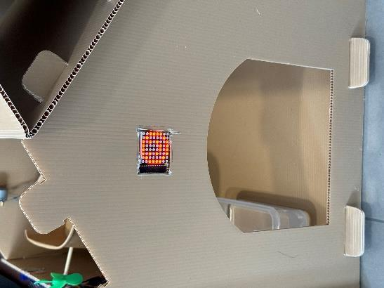
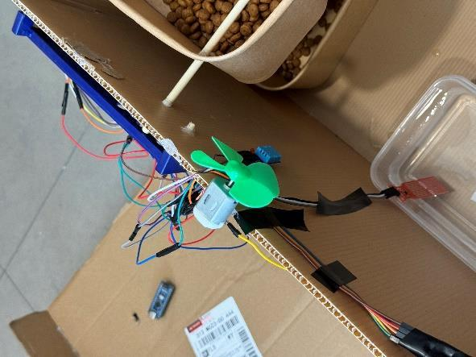

# Design notes

## Functional organization

The cat-house prototype combines several local Arduino-controlled modules. The project summary below is based on the cat-house-specific section of the supplied coursework report and its prototype photographs. It is a synthesized technical description, not a reproduction of the report.

### Feeding mechanism

A motor rotates a rod in the food container to dispense food on a schedule. The report discusses a short motor activation and a repeated feeding interval. No source code or recorded dose-versus-time data is available, so this repository does not specify a verified schedule, portion mass or feeding accuracy. A calibrated mechanism would need to account for the actual motor, rod, food geometry and supply voltage.

### Temperature and humidity

A DHT11 module provides ambient temperature and humidity readings to the local display. The reported temperature response enables the fan when temperature exceeds 27 °C and changes the OLED message. The source does not establish filtering, hysteresis, sensor-failure behavior or a measured closed-loop cooling result. The threshold is a historical project setting, not a general care recommendation.

### Water-level indication

The detailed description uses a water sensor to trigger a low-level indication and buzzer alert, clearing the alert when the reported level recovers. A source flowchart contains an example raw threshold, but the firmware, sensor calibration and exact timing are unavailable; those values are not converted into reproducible configuration instructions here. Automatic replenishment mentioned in the broad motivation is not claimed as an implemented feature.

### Presence-responsive display

The reported HC-SR501 PIR input changes an LED matrix to a smiling expression. PIR detects changes in infrared input and should be interpreted as an approximate trigger for this demonstration. The materials do not contain detection-rate measurements or evidence of species recognition.

## Mechanical and electrical assembly

The photographs show a modular cardboard house, a separate food container/rotating mechanism, a small fan, a water container/sensor and breadboard-mounted electronics. The source narrative describes reuse of cardboard and a cleaned disposable rod in the feeding mechanism. A solar-power backup is also discussed, but its electrical design and energy performance are not documented sufficiently for reproduction.

The source's illustrated circuit is a simplified interface drawing, not a verified as-built schematic. No PCB files, CAD dimensions, confirmed controller variant, complete BOM or original firmware were supplied. Consequently, this repository does not invent a pin map or a wiring/build guide.

## Material selection

The cat-house-specific PDF narrative and prototype figures are used for the summary. Another mixed document contains flowerpot, soil-watering and curtain-control passages; those passages are excluded from this project's technical claims. A text attachment contains unrelated software licensing text rather than project code and is not included.

The original firmware loss was confirmed by the project owner. The supplied demonstration is the main presentation artifact. No detailed per-person allocation is published; the work is described at project-team level.
